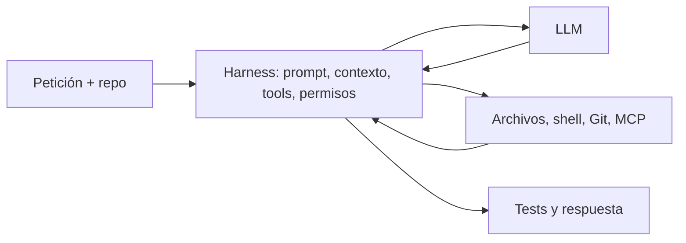

# Dentro de los agentes de programación: comparativa de modelos, prompts y arquitecturas

**Borrador de investigación.** Consulta inicial: 25-10-2026. Véase el [inventario de agentes](../research/02-catalogo-agentes.md), [referencias](../research/13-referencias.md) e [incertidumbres](../research/incertidumbres.md). No se ejecutaron benchmarks propios.

Consulta el [muestrario de extractos de prompts](../docs/14-muestras-prompts.md) para ver muestras breves con procedencia y nivel de evidencia.

## Un modelo no es un agente

Cuando un agente cambia un repositorio, el modelo no abre archivos ni ejecuta pruebas por sí solo. El harness prepara herramientas y contexto, recibe una respuesta y decide si valida/ejecuta una acción. Las reglas de proyecto, permisos, skills y entorno completan el sistema.

## System prompt, template y contexto

Un system prompt es el mensaje de instrucciones enviado al modelo. Un chat template serializa roles/tokens para el modelo. Los archivos como `AGENTS.md`, `GEMINI.md` o `QWEN.md` son instrucciones del proyecto que el harness puede agregar al contexto. No son intercambiables.

Codex publica `codex-rs/models-manager/prompt.md`, fragmento oficial que no debe tratarse como único prompt efectivo. Gemini CLI permite exportar o reemplazar su prompt con `GEMINI_SYSTEM_MD`; el reemplazo es completo y ofrece variables para añadir tools, skills y subagentes ([doc](https://github.com/google-gemini/gemini-cli/blob/main/docs/cli/system-prompt.md)). OpenCode construye componentes del prompt según proveedor, skills y MCP ([código](https://github.com/anomalyco/opencode/blob/dev/packages/opencode/src/session/system.ts)). En todos, configuración y modo alteran la entrada.

## Comparación orientada por evidencia

| Sistema | Qué se verifica | Límite |
|---|---|---|
| Codex CLI | Rust abierto, prompt parcial y lector AGENTS.md | un archivo no es toda sesión |
| Gemini CLI | PromptProvider, reemplazo/exportación, contexto/compactación documentados | requiere fijar config para conocer prompt efectivo |
| OpenCode | system builder, agentes primarios/secundarios configurables | docs/código cambian con la rama |
| Claude Code | producto Anthropic y documentación; prompt de creación de agentes público | no equivale a prompt principal/runtime completo |
| Kimi Code | CLI oficial Moonshot; coder/explore/plan anunciados | contrastar implementación exacta del aislamiento |
| Qwen Code | código del prompt, QWEN.md y subagentes configurables | el proveedor/modelo se selecciona por configuración |
| Cursor/Windsurf/Devin | documentación de producto | prompt/harness interno no auditable íntegramente |
| Trae Agent / MCode / ZCode / MiMo Code | repos oficiales identificados | rutas y commits faltan; no confundir con modelos homónimos |
| DeepSeek/GLM/Doubao/Hunyuan/ERNIE | modelos/API o productos | no asumir que cada familia tiene CLI oficial de coding |

Fuentes de detalle, incluyendo Cline, Roo, OpenHands, Aider, SWE-agent y Continue, están en el catálogo y trazabilidad. Las extracciones comunitarias de prompts se mantienen separadas de fuentes oficiales.

## Contexto, delegación y skills

La ventana máxima no dice cuántos tokens ni qué archivos llegan al modelo. Deben registrarse instrucciones, historial, retrieval, resultados de herramientas, memoria, compactación y uso de caché. Gemini, por ejemplo, documenta la búsqueda jerárquica de `GEMINI.md` y un prompt de compresión.

Subagentes añaden otra inferencia y transferencia de contexto; es necesario medir qué brief recibe cada uno, qué herramientas/permisos posee, si comparte workspace, cuánto cuesta y cómo se revisa.

[Superpowers](https://github.com/obra/superpowers) instala skills/metodología sobre un agente compatible. Su skill de desarrollo delegado describe implementadores frescos por tarea, revisión de especificación/calidad, correcciones y revisión global ([fuente](https://github.com/obra/superpowers/blob/main/skills/subagent-driven-development/SKILL.md)). El host aporta subagent dispatch, herramientas y workspace. La skill no crea sandbox o aislamiento automáticamente.

## ¿Qué parte depende de cada capa?

No hay un porcentaje universal. El modelo condiciona capacidad de inferencia/generación; el prompt prioriza conductas; el harness delimita acciones, contexto, permisos y bucle. Una instrucción de “verifica” no demuestra que se ejecutaron tests. La relación es interactiva y los leaderboards de agentes no aíslan estos factores.

## Protocolo

Se proponen seis estudios: (A) un modelo con prompts distintos; (B) un modelo en harnesses distintos; (C) mismo harness con modelos distintos; (D) con/sin subagentes; (E) con/sin skills; (F) contextos/presupuestos distintos. Congelar repos/base commit, snapshots, prompts, tools, permisos, entornos, límites y reglas de evaluación. Registrar tests externos, regresiones, tiempo, tokens, coste, llamadas, retries, delegaciones y uso de contexto.

SWE-bench Verified reúne 500 tareas expertamente verificadas según fuentes del benchmark ([OpenAI](https://openai.com/index/introducing-swe-bench-verified/), [dataset](https://github.com/SWE-bench/SWE-bench/blob/main/docs/guides/datasets.md)). No resuelve diferencias de scaffold, ambiente ni contaminación. No se atribuye su puntuación al LLM aislado.

## Conclusión provisional

El comportamiento emerge de **modelo + prompt efectivo + harness + contexto + entorno**. El harness controla lo que se puede ejecutar; modelo y prompt afectan qué se propone y con qué calidad. Su contribución relativa depende de tarea y solo se estima con experimentos controlados.

**Límite de esta versión:** faltan fijación de commits, rutas puntuales de varios agentes, snapshots completos del catálogo de modelos/precios y verificación adicional de algunos agentes oficiales chinos. No hay resultados experimentales propios ni ranking.
