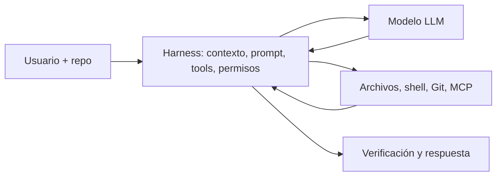

# 01. Introducción

**Consulta inicial: 25-10-2026.** Esta investigación responde a: ¿cuánto del comportamiento depende del modelo, del prompt y del harness? No existe un porcentaje universal defendible sin intervenciones controladas. El modelo genera decisiones; las instrucciones orientan; el harness determina herramientas, contexto, permisos, ejecución, errores, estado y parada. Skills, configuración y entorno añaden variables e interacciones.

| Capa | Qué controla | Qué no demuestra por sí sola |
|---|---|---|
| Modelo | generación, razonamiento, tool-call formatting, seguimiento de instrucciones | ejecución local, acceso a archivos, seguridad efectiva |
| System/developer prompt | rol, prioridades, reglas, formatos, estrategia | que el modelo obedezca siempre |
| Harness | bucle, herramientas, mensajes, retries, permisos, memoria, finalización | calidad de modelo universal |
| Entorno | repo, shell, red, pruebas, sandbox | generalización a otras tareas |

**System prompt** es una instrucción serializada como mensaje de sistema; no es el chat template del modelo ni las instrucciones del proyecto. **Harness** es el software que monta la conversación, llama al modelo y ejecuta/valida acciones. **Agente** es la combinación modelo + prompts + harness + herramientas + configuración + entorno.

La comparación causal requiere cambiar una variable manteniendo las demás. Benchmarks de producto mezclan modelo, scaffold, prompt, herramientas, presupuesto y configuración; no aíslan el efecto de cada capa. Las fuentes en ramas `main` son localizadores mutables: fijar SHA antes de publicar versión final. No se ejecutaron agentes ni benchmarks propios.
