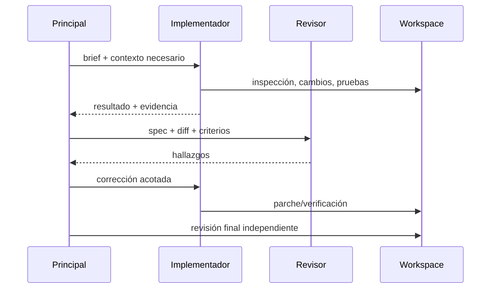

# 07. Subagentes y orquestación

La etiqueta “subagentes” no dice qué prompt reciben, si heredan historial, si comparten workspace, qué tools tienen, cómo se paralelizan, qué devuelven o quién integra.

OpenCode documenta primary/subagents, prompt/model/tools configurables y Plan con acceso restringido. Kimi Code README declara coder/explore/plan en contextos aislados. Qwen Code documenta subagentes con prompt Markdown, modelo y tools configurables. Gemini soporta agentes remotos y sección dinámica de subagents. Esto prueba capacidades expuestas, no eficacia ni seguridad medida.

Para cada dispatch registrar modelo, system/developer prompt, contexto exacto, herramientas/permisos, workspace, concurrencia, presupuesto, salida, errores e integración. Verificar aislamiento en runtime, no asumirlo por descripción.
