# Guion del deck: orquestadores de agentes de código por dentro

Guion diapositiva a diapositiva (Tarea 5). Fuentes únicas: `STUDY.md`, `TABLAS.md`, `REFS.md`, `study/*.md`, `study/flows/*.md`, `presentacion/mermaid/*.mmd` y los HTML de `presentacion/flows/`. Los bloques Mermaid están pegados tal cual desde su `.mmd` y quedan pendientes de validar renderizándolos en la Tarea 6 (tabla «Mapa de diagramas» al final). Las cifras de GitHub son de la API, consultadas el 2026-11-21. Lo que no se leyó se dice: «no leído», «no verificado», «según docs».

---

### Diapositiva 1: Orquestadores de agentes de código: cómo funcionan por dentro

- Nueve repos que reparten trabajo entre un coordinador y varios agentes que programan.
- Cinco vistos por dentro: arquitectura, ciclo de una tarea, prompt clave y skills.
- Por qué importa: el mismo patrón aparece con cinco reparticiones distintas de qué decide el LLM y qué decide el código.
- Todo es lectura de código y documentación: no se ejecutó nada.
- No es un ranking: no hay «mejor» ni «peor».

Notas del orador: estudio de solo lectura del 2026-11-21; las rutas completas están en el anexo.

### Diapositiva 2: El patrón Router/Worker en una diapositiva

- **Router**: coordinador residente; decide qué merece atención y reparte. Solo él habla con el usuario.
- **Worker**: ejecutor aislado (sesión y directorio propios) que hace el trabajo y reporta al Router.
- **Watchdog**: vigila que los Workers no se cuelguen ni se pierdan.
- La idea viene del diseño «Super-agent» de DeepSeek (artículo original no localizado: lo conocemos por su prototipo y por resúmenes de terceros).
- La pregunta que recorre el deck: ¿qué parte decide un LLM y qué parte es código determinista?

Fuente: estudio: STUDY.md §1 y §4; REFS.md §2

### Diapositiva 3: El mapa: nueve repos por familias

- **Linaje DeepSeek Super-agent**: `dsh-superagent-prototype`, `deepseek-super-agent` (LofiSu, hoy `dsh-super-agent`), `cc-super-agent`, `super-super-harness`.
- **Orquestadores de agentes de código**: `agent-orchestrator`, `agent-swarm`, `cli-agent-orchestrator` (CAO), `gastown`.
- **Contraste**: `deer-flow`. Es de ByteDance y no tiene relación con el linaje de diseño de DeepSeek: comparte la palabra «super agent», no el patrón (no es Router/Worker: un único *lead agent*).
- Tratamiento completo en este deck: dsh, cc-super-agent, agent-orchestrator, CAO y gastown. Los otros cuatro, solo en las comparativas.
- Árbol por los siete ejes del estudio: [mapa-nueve-repos.tree.html](../flows/mapa-nueve-repos.tree.html)

Fuente: estudio: STUDY.md §1 y §10; TABLAS.md §2

Notas del orador: el orden del árbol no es un ranking.

### Diapositiva 4: Popularidad no es calidad

| Repo | Estrellas | Commits | Dato |
|---|---:|---:|---|
| `bytedance/deer-flow` | 85.571 | 4.931 | API, 2026-11-21 |
| `deepseek-ai/dsh-superagent-prototype` | 24.127 | 1 | API, 2026-11-21 |
| `gastownhall/gastown` | 18.862 | 7.783 | API, 2026-11-21 |
| `OrchestratorInc/agent-orchestrator` | 14.996 | 4.379 | API, 2026-11-21 |
| `awslabs/cli-agent-orchestrator` | 1.619 | 797 | API, 2026-11-21 |
| `desplega-ai/agent-swarm` | 1.097 | 3.989 | API, 2026-11-21 |
| `LofiSu/dsh-super-agent` | 146 | 375 | API, 2026-11-21 |
| `yingpengma/cc-super-agent` | 7 | 29 | API, 2026-11-21 |
| `ketchupz1999/super-super-harness` | 1 | 6 | API, 2026-11-21 |

- El prototipo de DeepSeek: 24.127 estrellas con 1 commit y 0 issues abiertas (API, 2026-11-21). Probable tirón de marca; no hay uso medido.
- deer-flow: 4.931 commits y 3 releases, última v2.2.0 (API, 2026-11-21); su `SECURITY.md` dice que no hay release oficial (paráfrasis; `deer-flow/SECURITY.md:5`).
- gastown (7.783 commits), agent-orchestrator (4.379) y agent-swarm (3.989) son proyectos con desarrollo activo; las estrellas no los distinguen de un prototipo de un solo commit.
- Las estrellas miden atención. Aquí no se usan para ordenar ni puntuar nada.

Fuente: estudio: TABLAS.md §1; REFS.md §3.1 y §3.2

### Diapositiva 5: dsh-superagent-prototype: arquitectura

- Código determinista alrededor de dos sesiones LLM: Router y Worker.
- Un bucle cada 2 s; el Engine es el único punto transaccional; el gate de admisión es código.
- SQLite más una cola durable de efectos (patrón outbox) para hablar con GitHub o Feishu.
- Una sesión y un directorio (worktree) por Ticket; ambas sesiones con `danger-full-access`: no hay sandbox.
- Diagrama completo: [dsh-superagent-prototype.architecture.html](../flows/dsh-superagent-prototype.architecture.html)

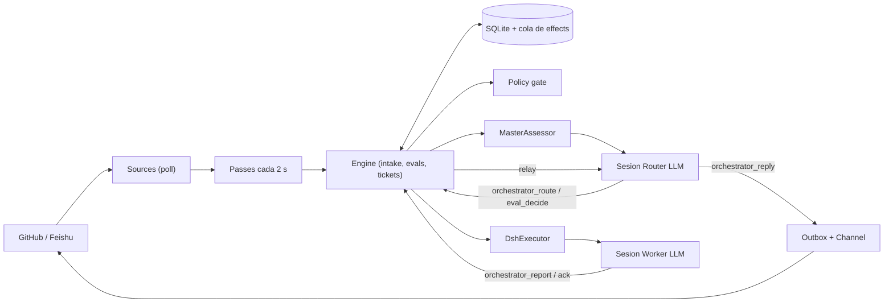

Fuente: dsh-superagent-prototype: src/core/engine.ts, src/app/passes.ts, src/policy.ts, src/app/sessions.ts

### Diapositiva 6: dsh-superagent-prototype: ciclo de vida de una tarea

- Caso: una persona autorizada menciona al agente en un issue y al final hay un PR.
- Decide un LLM en 4 de los 12 pasos (4, 7, 9 y 11); el resto es código, incluido el gate.
- «LLM propone, código dispone»: el Engine rechaza un *accept* inferido fuera del modo `auto`.
- CI y comentarios posteriores llegan al Worker por Subscription, sin gate ni LLM.
- Secuencia completa: [dsh-superagent-prototype.sequence.html](../flows/dsh-superagent-prototype.sequence.html)

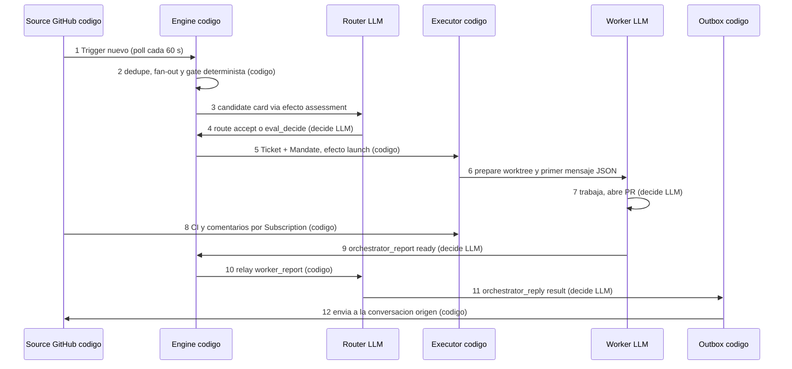

Fuente: dsh-superagent-prototype: src/sources/github.ts, src/core/intake.ts, src/core/evals.ts, prompts/dispatch.md

### Diapositiva 7: dsh-superagent-prototype: prompt clave y skills

```text
Outside an assessment, the orchestrator must not inspect code, detailed logs, linked documents or technical discussion, or solve worker blockers itself; leave those activities to workers.
Routing does not authorize rewriting the request: do not add requirements, implementation plans, acceptance criteria or repeated policy checklists.
Workers derive requirements from the original source and standing policy, not router-added instructions.
```
Origen: `prompts/shared.md:5-7` · Licencia: MIT

- **Skills del PRODUCTO**: 2, `dsh-superagent-github` (siempre) y `dsh-superagent-feishu` (solo con bot Feishu); se registran en cada sesión.
- **Skills de desarrollo del repo**: no encontradas (búsqueda por nombre; `.claude/` y `.agents/` sin skills).
- Ojo, PROMETIDO: el Router «no lee código» por prompt, pero conserva `bash` y `read` en su allowlist.
- Ojo, sin resolver: el preset del Router carga el plugin `agent-instructions` (AGENTS.md) y la doc dice que la sesión principal no lo lee. Efecto real no verificado.

Fuente: dsh-superagent-prototype: prompts/shared.md, skills/*/SKILL.md, src/app/sessions.ts, cordis.patch.yml

### Diapositiva 8: cc-super-agent: arquitectura

- ~1.300 líneas: casi toda la lógica es prompt (`AGENTS.md`), el resto Bash y una web en Node.
- Router: Claude Code interactivo dentro de tmux, relanzado en bucle por `router/loop.sh`.
- Dispatch en Bash: cola con `flock`, máximo 3 Workers, reintentos, `--resume` de sesión.
- Worker: `claude -p` en el directorio del proyecto, sin sandbox; estado en Markdown (`INDEX.md`, `tasks/`).
- Watchdog: cron cada 15 min con un LLM que solo diagnostica y marca, nunca reinicia.
- Diagrama completo: [cc-super-agent.architecture.html](../flows/cc-super-agent.architecture.html)

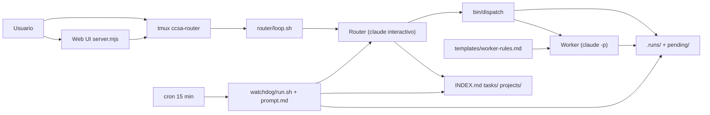

Fuente: cc-super-agent: AGENTS.md, router/loop.sh, bin/dispatch, watchdog/run.sh

### Diapositiva 9: cc-super-agent: ciclo de vida de una tarea

- El Router clasifica, confirma («On it: ...»), registra primero y luego despacha: todo eso es LLM.
- `bin/dispatch` (Bash) pone la cola, el slot y el `session-id`, y reintenta solo errores transitorios con backoff.
- El Worker cierra con `Status / Result / Question`; ese formato lo impone solo el prompt, sin validación en código.
- El Router reescribe el informe para el usuario: nunca lo reenvía tal cual.
- Secuencia completa: [cc-super-agent.sequence.html](../flows/cc-super-agent.sequence.html)

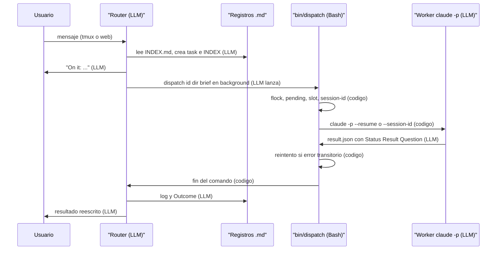

Fuente: cc-super-agent: AGENTS.md, bin/dispatch, templates/worker-rules.md

### Diapositiva 10: cc-super-agent: prompt clave y skills

```text
**Take as little of the user's attention as possible, and give as much value as possible.**   (AGENTS.md:9)
The Router does not do the work itself. It does not read the code of other projects, investigate problems or design solutions. [...]   (AGENTS.md:27)
1. **Pass on the user's own words.** The brief quotes the user's request verbatim. [...]   (AGENTS.md:50)
2. **Attach a message to existing work only when it clearly points there.** [...]   (AGENTS.md:51)
- Do not forward a Worker's report as it is. Extract what the user needs and write it fresh.   (AGENTS.md:107)
**Record first, then act.** [...]   (AGENTS.md:213)
```
Origen: `AGENTS.md:9, 27, 50, 51, 107, 213` (líneas no contiguas) · Licencia: MIT

- **Cero skills, cero hooks, todo es prompt**: ni `.claude/skills`, ni `SKILL.md`, ni `settings.json` propio.
- La «habilidad» vive en `AGENTS.md` (vía `CLAUDE.md` = `@AGENTS.md`) y en `templates/worker-rules.md` (vía `--append-system-prompt`).
- Ojo: el Watchdog tiene `Edit` y `Write` sin restricción de ruta, aunque su prompt diga «solo `INDEX.md` y `tasks/`».

Fuente: cc-super-agent: AGENTS.md, CLAUDE.md, templates/worker-rules.md, watchdog/run.sh, watchdog/prompt.md

### Diapositiva 11: agent-orchestrator: arquitectura

- Daemon en Go (frontend Electron/React): un **agente orquestador LLM** más **enrutado determinista en Go** de eventos de CI, review y conflictos.
- SCM Observer cada 30 s, Reaper cada 5 s (solo vida) y un Lifecycle Manager que convierte hechos en avisos (*nudges*).
- `sessionguard` relee el estado de la sesión justo antes de escribir en su terminal.
- Almacenamiento SQLite (WAL, escritor único, unas 215 migraciones); el código de `store/` no se leyó a fondo.
- Cobertura de lectura baja (~3-4 % de los ficheros en la 1.ª ronda y ~50 más de lifecycle y Windows en la 2.ª; STUDY §10 y §12): lo que no aparece aquí puede existir.
- Diagrama completo: [agent-orchestrator.architecture.html](../flows/agent-orchestrator.architecture.html)

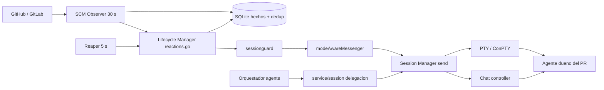

Fuente: agent-orchestrator: backend/internal/observe/scm/observer.go, backend/internal/lifecycle/reactions.go, backend/internal/sessionguard/guard.go

### Diapositiva 12: agent-orchestrator: ciclo de vida de un fallo de CI

- Caso: un CI falla en el PR de una sesión. En lo leído, ningún LLM interviene hasta el último paso (el agente dueño del PR corrige y hace push).
- Deduplicación por firma, persistida; un aviso repetido tras reinicio se prefiere a uno perdido.
- La firma de CI incluye el commit: cada push que siga fallando genera un aviso nuevo, sin tope. No hay detector de «vivo pero atascado»: `no_signal` es solo una etiqueta a los 90 s (STUDY §12).
- Estados de sesión simplificados de `domain.Activity`; la doc de arquitectura dibuja estados extra que no son campo real.
- Regla de terminación: una sonda fallida no prueba que la sesión esté muerta.
- Secuencia completa: [agent-orchestrator.sequence.html](../flows/agent-orchestrator.sequence.html)

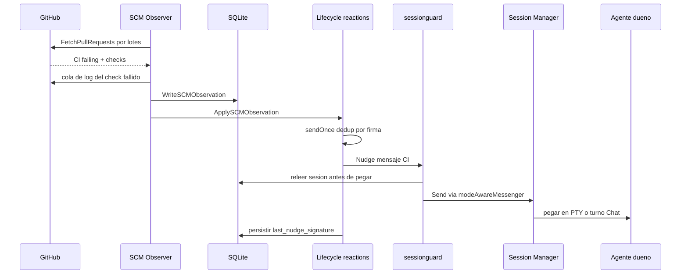

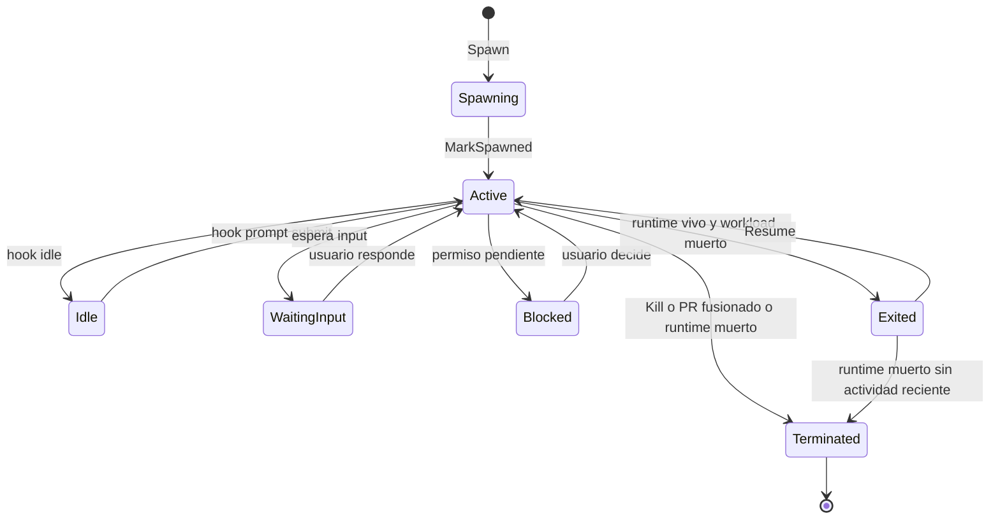

Fuente: agent-orchestrator: backend/internal/observe/scm/observer.go, backend/internal/lifecycle/reactions.go, backend/internal/lifecycle/manager.go, backend/internal/observe/reaper/reaper.go

### Diapositiva 13: agent-orchestrator: prompt clave y skills

```text
You are the human-facing orchestrator for project %s.
Your job is to coordinate work, not to perform implementation. [...]
- For every implementation, fix, test, or PR update task, always spawn or redirect a worker session; do not perform the task in the orchestrator session.
- Never ever make code changes directly in the orchestrator session.
- Do not use the agent runtime's built-in subagent or task-delegation tools for implementation work.
```
Origen: `backend/internal/session_manager/prompt.go:243, 245, 250, 253, 260` (líneas no contiguas) · Licencia: Apache-2.0

- **Skills del PRODUCTO**: `using-ao` (catálogo del CLI `ao` y 30 ficheros de comandos) y `bug-triage`, embebidas con `go:embed` e instaladas en cada arranque; el agente las lee bajo demanda.
- **Skills de desarrollo del repo**: `.claude/skills/ao-desktop-dev` y `bug-triage`; sus versiones canónicas en `.agents/skills/` no se leyeron.
- **Hallazgo de seguridad**: con Codex en modo Chat, el modo *default* (y el *bypass*) corre con aprobación `never` y `danger-full-access`. En lo leído, el aislamiento es el worktree; otro mecanismo no encontrado (cobertura baja).

Fuente: agent-orchestrator: backend/internal/session_manager/prompt.go, backend/internal/skillassets/skillassets.go, backend/internal/adapters/chatdriver/codexappserver/driver.go

### Diapositiva 14: cli-agent-orchestrator (CAO): arquitectura

- Supervisor LLM en tmux que delega con herramientas MCP (`handoff`, `assign`, `assign_elastic`); no se encontró router en código.
- `cao-mcp-server` es un cliente delgado; el trabajo lo hace `cao-server` (FastAPI) con SQLite.
- Cada Worker es otro CLI agente en otra ventana tmux; no se encontró sandbox local (cobertura ~20 %).
- El estado del Worker se deduce leyendo su pantalla (`status_monitor`).
- `cao-server` expone 123 rutas y su autenticación viene **apagada por defecto** (se activa con variables de entorno); cobertura ~15-20 % del código relevante (STUDY §12).
- Diagrama completo: [cli-agent-orchestrator.architecture.html](../flows/cli-agent-orchestrator.architecture.html)

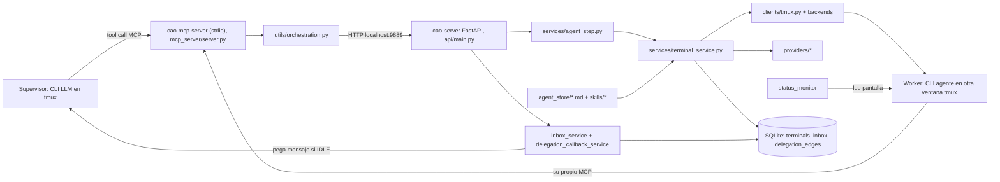

Fuente: cli-agent-orchestrator: src/cli_agent_orchestrator/mcp_server/server.py, src/cli_agent_orchestrator/utils/orchestration.py, src/cli_agent_orchestrator/services/agent_step.py

### Diapositiva 15: cli-agent-orchestrator (CAO): ciclo de una delegación

- `handoff`: el supervisor llama UNA herramienta y se queda bloqueado; los pasos 2 a 11 son código.
- El resultado se persiste ANTES de desmontar el terminal; en timeout o error el terminal no se borra.
- `assign` es asíncrono: la respuesta vuelve por el inbox cuando el supervisor queda IDLE; si el Worker calla, el servidor reenvía su última salida.
- El README del ejemplo K8s admite fallos del detector de fin de turno (un «success» a los 3,1 s en una tarea de 36 s). El código no lo mitiga: el broker lo detecta a posteriori y el supervisor sigue recibiendo `success: true` (STUDY §12).
- Secuencia completa: [cli-agent-orchestrator.sequence.html](../flows/cli-agent-orchestrator.sequence.html)

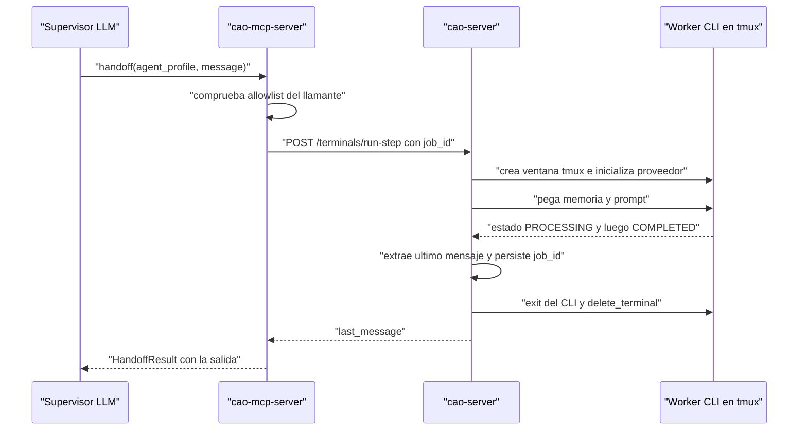

Fuente: cli-agent-orchestrator: src/cli_agent_orchestrator/utils/orchestration.py, src/cli_agent_orchestrator/services/agent_step.py, src/cli_agent_orchestrator/services/delegation_callback_service.py

### Diapositiva 16: cli-agent-orchestrator (CAO): prompt clave y skills

```markdown
## Critical Rules
1. **NEVER write code directly yourself**. Your role is strictly coordination and supervision.
2. **ALWAYS assign actual coding work** to the Developer Agent.
3. **ALWAYS assign code reviews** to the Code Reviewer Agent.
4. **ALWAYS maintain absolute file paths** for all code artifacts created during the workflow.
5. **ALWAYS write task descriptions to files** before assigning them to worker agents.
6. **ALWAYS instruct worker agents** to work on tasks by referencing the absolute path to the task description file.
```
Origen: `src/cli_agent_orchestrator/agent_store/code_supervisor.md:27-33` · Licencia: Apache-2.0

- **Skills del PRODUCTO**: 8 de protocolo (supervisor, worker, routing, sesión, memoria, aprendizaje, workflow) más las opcionales de UI y MCP Apps.
- **Skills de desarrollo del repo**: 5 (`cao-contributing`, `cao-plugin`, `cao-provider` y dos de plugins). Matiz: las 16 empaquetadas se siembran todas, así que también son cargables; la división es por propósito, no por mecanismo.
- Discrepancias sin resolver: `entrypoint.sh` habla de 12 árboles de skills y hay 16; el prompt de `developer.md` promete el banner `[CAO Handoff]` y el código solo lo añade para Codex; no se encontró la variable de entorno de `ENABLE_WORKING_DIRECTORY`.
- El bloque «Security Constraints» de los perfiles es solo texto; el control real son las allowlists.

Fuente: cli-agent-orchestrator: src/cli_agent_orchestrator/agent_store/code_supervisor.md, src/cli_agent_orchestrator/agent_store/developer.md, src/cli_agent_orchestrator/utils/skills.py, docs/agent-plugins.md

### Diapositiva 17: CAO en Kubernetes: broker de privilegios mínimos (ejemplo de workshop)

- Es un ejemplo de workshop en `examples/`, con partes marcadas «UNVERIFIED»: no es el modo por defecto.
- El pod supervisor no crea pods: pide un Worker al broker; el broker no tiene `pods/exec` ni `secrets`.
- La pasarela del broker reescribe `sender_id` y el contexto de memoria con los datos del lease: no se fía del Worker.
- El LLM del Worker llama `complete_assignment`; la entrega por la pasarela y la liberación del lease las hace el código.
- Los leases viven en memoria del broker: un reinicio pierde el registro. El barrido de huérfanos («orphan sweep») no se leyó a fondo.

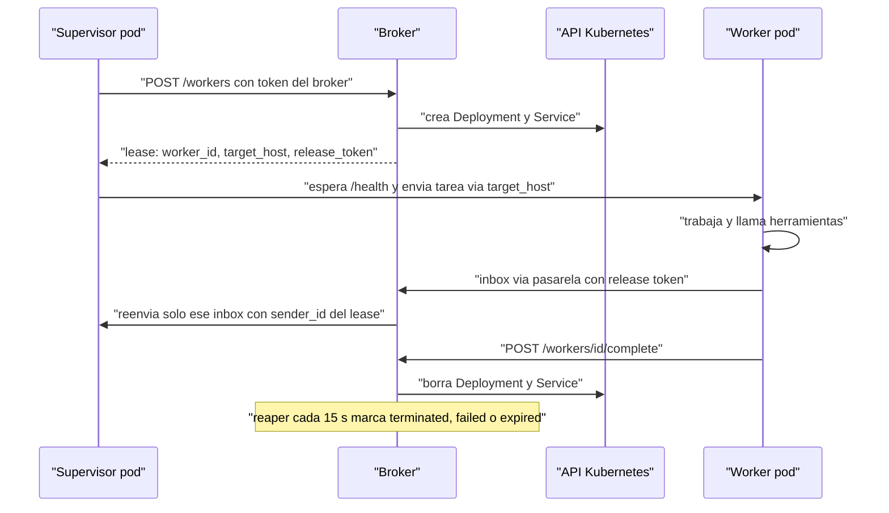

Fuente: cli-agent-orchestrator: examples/cao-clusters/kubernetes/eks/broker.py, examples/cao-clusters/kubernetes/eks/rbac.yaml, src/cli_agent_orchestrator/mcp_server/server.py

### Diapositiva 18: gastown: arquitectura

- Supervisión en capas: un daemon Go determinista y varios agentes LLM con rol (Mayor, Deacon, Boot, Witness, Refinery, Dogs).
- El Mayor (LLM) coordina; `gt sling` (Go) despacha con guardas, locks y rollback.
- Polecats: Workers en tmux y git worktree; estado compartido en Dolt (SQL versionado) con Beads.
- Refinery: existe un motor Go de merge por lotes con bisección (`engineer.go`, `batch.go`), pero **no tiene llamador fuera de tests**: la fusión real la hace un agente LLM con `gt mq` (STUDY §12).
- Diagrama completo: [gastown.architecture.html](../flows/gastown.architecture.html)

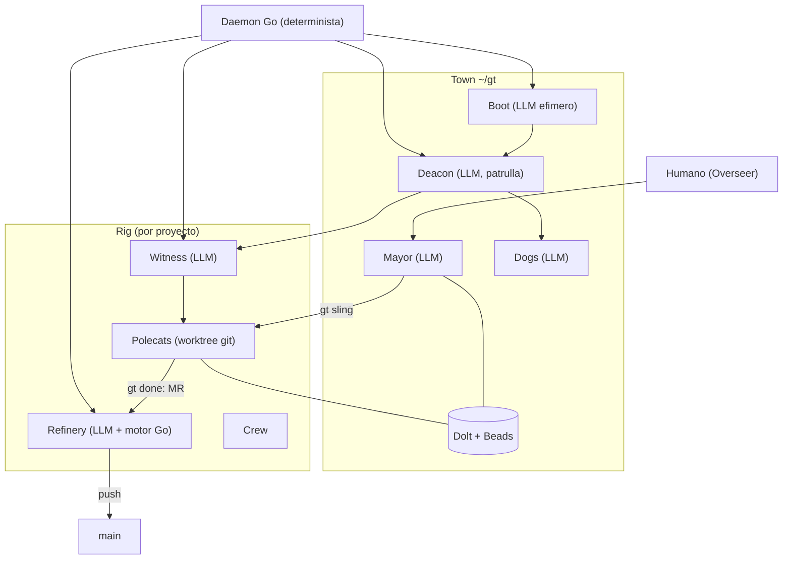

Fuente: gastown: internal/daemon/daemon.go, internal/cmd/sling.go, internal/refinery/engineer.go, internal/templates/roles/refinery.md.tmpl

### Diapositiva 19: gastown: ciclo de vida de una tarea y estados del polecat

- `gt sling` arranca la sesión del polecat DESPUÉS de fijar su trabajo, para que `gt prime` ya lo vea al inyectar el contexto.
- El polecat sigue el checklist de la fórmula `mol-polecat-work` y termina con `gt done` (push y petición de merge).
- **Ciclo del polecat CONTRADICTORIO en la documentación**: una doc dice «no idle reuse», la fórmula «Done means gone» y el código describe un polecat persistente que pasa a idle. El diagrama de estados es una reconstrucción, no un hecho.
- Secuencia completa: [gastown.sequence.html](../flows/gastown.sequence.html)

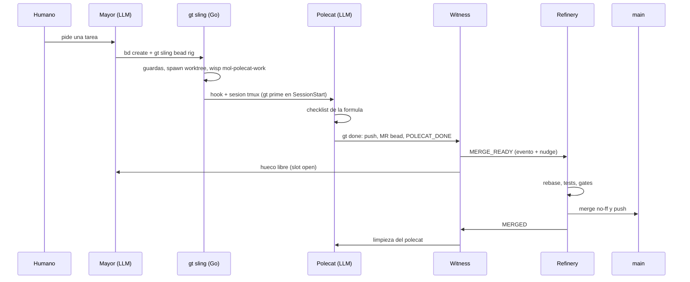

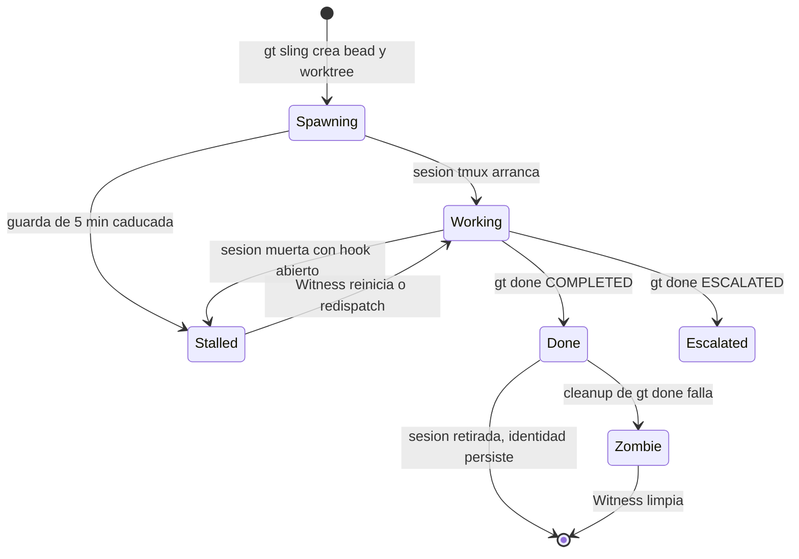

Fuente: gastown: internal/cmd/sling.go, internal/cmd/prime.go, docs/concepts/polecat-lifecycle.md, internal/witness/handlers.go

### Diapositiva 20: gastown: prompt clave y skills

```text
User request → bd create "..." → {{ cmd }} sling <bead-id> <rig>
(...)
If you're unsure, sling it. Slinging is always safe; doing it yourself eats
context you can't get back.
### The Solo Artist trap
Claude's instinct is "I can do this, so I will." (...)
**Anti-pattern**: Doing everything yourself while the polecat pool sits idle.
```
Origen: `internal/templates/roles/mayor.md.tmpl:44, 63-64, 66, 68, 73` (líneas no contiguas) · Licencia: MIT

- **Skills de desarrollo del repo**: 4 en `.claude/skills` (`crew-commit`, `pr-sheriff`, `pr-list`, `ghi-list`); no se encontró que se provisionen a los polecats.
- **Del PRODUCTO**: no son skills sino 53 fórmulas TOML embebidas en el binario y tres slash commands provisionados (`done`, `handoff`, `review`).
- Contradicción resuelta en la 2.ª pasada: la plantilla del Refinery dice que decide el LLM, «not Go code», y el motor Go de merge existe pero nadie lo llama en producción.

Fuente: gastown: internal/templates/roles/mayor.md.tmpl, internal/templates/roles/refinery.md.tmpl, internal/formula/embed.go, .claude/skills

### Diapositiva 21: gastown: la cadena de vigilancia

- Cada tick del daemon: si hay E-stop o apagado, no gestiona agentes.
- Boot (sesión LLM nueva por tick) decide si despertar al Deacon; se salta si el Deacon está sano y sin trabajo, y degrada a triage mecánico sin LLM.
- La detección de atascos de los agentes **no es automática**: las primitivas (ping con 3 fallos y enfriamiento de 5 min, `gt deacon health-check` y `force-kill`) existen, pero nadie las invoca; el Deacon, un LLM, decide con su prompt («you decide the thresholds»). Lo único automático y determinista es el daemon sobre el propio Deacon: aviso entre 5 y 20 min sin heartbeat y kill pasados 20 min. El re-despacho (`redispatch.go`) no se verificó (STUDY §12).
- Intervalo del heartbeat: 3 min por defecto (`internal/config/operational.go:48`), configurable.

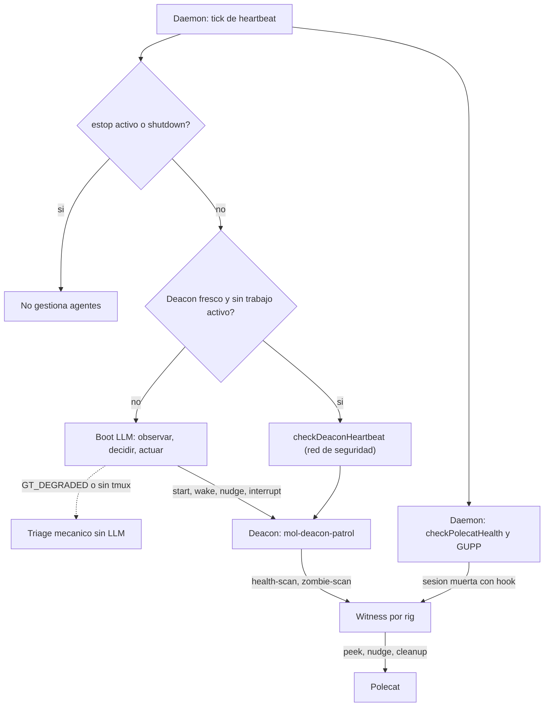

Fuente: gastown: internal/daemon/daemon.go, internal/daemon/types.go, internal/deacon/stuck.go, internal/deacon/redispatch.go

### Diapositiva 22: Comparativa de capacidades (nueve repos)

| Repo | Quién coordina | Aislamiento del Worker | Estado | Watchdog | Aceptación verificada por código |
|---|---|---|---|---|---|
| dsh | Router LLM + gate determinista | worktree, sin sandbox | SQLite + outbox | ❌ no como componente | ❌ |
| cc-super-agent | Router LLM, todo en prompt | dir del proyecto, sin sandbox | Markdown | ⚠️ LLM por cron, solo avisa | ❌ |
| LofiSu | Router con fast path en código | ⚠️ solo macOS y Linux | SQLite | ✅ en código | ⚠️ regex |
| super-super-harness | Claude Code con herramientas MCP + reglas | worktree, sin sandbox | SQLite WAL | ⚠️ repartido | ⚠️ origen, no resultado |
| deer-flow | lead único (no Router/Worker) | ⚠️ `local` flojo | SQL + checkpoints | ⚠️ repartido | ✅ |
| agent-orchestrator | agente LLM + enrutado Go | worktree; sin sandbox propio (solo limpia contenedores) | SQLite WAL | ⚠️ solo vida; `no_signal` es una etiqueta | ⚠️ estado del PR derivado de hechos de SCM |
| agent-swarm | lead LLM + enrutado previo | Docker; endurecimiento apagado por defecto | SQLite | ✅ en código (A y B remedian; C solo registra) | ❌ autoinforme en `/finish` |
| CAO | supervisor LLM con MCP | sin sandbox local; pods desechables en K8s (ejemplo) | SQLite + ficheros | ⚠️ regex sobre pantalla | ❌ «falsa victoria» sin mitigar |
| gastown | Mayor LLM + despacho Go | worktree + tmux; sin sandbox (el proxy mTLS no se usa por defecto) | Dolt | ⚠️ daemon (código) y agentes LLM | ⚠️ merge por agente LLM; el motor Go no se llama |

- ✅ en código · ⚠️ parcial o solo por prompt · ❌ no existe (buscado en el código) · ❓ no encontrado con cobertura baja: no equivale a «no hay».

Fuente: estudio: TABLAS.md §3-§5; STUDY.md §10.1 y §10.2

### Diapositiva 23: El patrón nuevo: coordinador LLM más enrutado determinista en código

- El coordinador es un agente LLM completo, no un clasificador barato.
- El LLM decide qué trabajo existe; el código decide a quién llega y cuándo.
- agent-orchestrator: reacciones a CI, review y conflictos en `lifecycle/reactions.go`.
- gastown: `gt sling` y el daemon. agent-swarm: elegibilidad por rol y capacidades (según runbook; el código de la elegibilidad no se leyó, el del watchdog sí).
- Matiz de la 2.ª pasada: en gastown parte de lo que parecía código (detección de atascos, cola de merge) no tiene llamador y depende del prompt. Conviene leer los llamadores y no solo las funciones.
- Antecedente: el gate determinista de dsh. Lo contrario: cc-super-agent, donde todo vive en el prompt.

Fuente: estudio: STUDY.md §10.2; agent-orchestrator: backend/internal/lifecycle/reactions.go; gastown: internal/cmd/sling.go

### Diapositiva 24: Huecos que nadie cubre (en lo leído)

- Aislamiento real y portable del Worker: hay Docker y K8s, pero con endurecimiento opcional y nada para Windows nativo.
- Defensa técnica contra prompt injection: en todos es textual («esto es dato, no instrucción»).
- Aceptación del resultado verificada por código: solo deer-flow, fuera del linaje Router/Worker.
- Control de coste por tarea: agent-swarm aplica presupuestos diarios en USD al reclamar y gastown trae `max_polecats` apagado por defecto; nadie pone tope por tarea ni por tokens.
- Evidencia de que la arquitectura dual compensa: el benchmark citado es sintético y de terceros; nadie lo midió con código real.
- Con cobertura del 3 al 45 %, «nadie» significa «no lo encontramos».

Fuente: estudio: STUDY.md §6 y §10.4; REFS.md §5

### Diapositiva 25: Ideas que merece la pena copiar

| Idea | De dónde |
|---|---|
| LLM propone, código dispone (gate y validación de la decisión) | dsh |
| Cola por sesión con `flock` y fusión de mensajes a un Worker ocupado | cc-super-agent |
| Hecho durable, efecto idempotente, acuse al final; «una sonda fallida no es muerte» | agent-orchestrator |
| Identidad fijada por el lanzador y techo de delegación guardado en la fila del padre | CAO |
| Broker que reescribe la identidad desde el lease (ejemplo de workshop) | CAO |
| Despacho idempotente con rollback; arrancar el Worker solo tras fijar su trabajo | gastown |

Fuente: estudio: STUDY.md §10.3; study/flows/*.md §7

### Diapositiva 26: Límites de confianza

| Repo | Cobertura de lectura |
|---|---|
| dsh-superagent-prototype | Alta: docs y código del flujo; sin leer `src/client`, tests, `store.ts` |
| cc-super-agent | Alta: repo casi entero (35 ficheros) |
| super-super-harness | Alta (primera ronda) |
| LofiSu | Media: muestreo |
| deer-flow | Media-baja: muestreo |
| agent-orchestrator | ~3-4 % de los ficheros; 2.ª pasada con ~50 ficheros de lifecycle, Windows y SQLite |
| agent-swarm | ~12-15 % de `src/` línea a línea; watchdog, auth y presupuestos verificados en código |
| cli-agent-orchestrator | ~15-20 % del código relevante (auth, API, orquestación, EKS) |
| gastown | ~40-45 % de lo relevante al flujo (nota de flujos); ~15-20 % en la primera ronda |

- Nada se ejecutó. Las citas `ruta:línea` salen de las notas: 807 comprobadas mecánicamente y 72 contrastadas con el código, ninguna contradicha (STUDY §0).
- Algunas líneas de CAO llegaron comprimidas y pueden estar desplazadas.

Fuente: estudio: STUDY.md §0 y §10; study/flows/*.md (párrafo «Cobertura»)

### Diapositiva 27: Anexo: referencias ruta:línea

Rutas relativas a `references/<repo>/`. Detalle y contexto en `study/flows/<repo>.md`.

- **D5 dsh, arquitectura**: `src/sources/github.ts:144, 232`; `src/app/passes.ts:28, 34, 63-68`; `src/core/engine.ts:19-23`; `src/policy.ts:191-212`; `src/app/effects.ts:60-87`; `src/app/assessment.ts:37-45`; `src/app/sessions.ts:138-155, 232-269`; `src/executor/dsh.ts:263-283, 424-455`; `src/app/outbox.ts:20-50`; permisos `src/app/sessions.ts:152`.
- **D6 dsh, ciclo**: `src/sources/github.ts:144, 228-232`; `src/core/intake.ts:19-60, 34-52`; `src/core/evals.ts:71-106, 118, 131-153, 152, 306-316`; `prompts/dispatch.md:5-6, 16-22`; `prompts/admission.md:1, 67`; `src/app/tools/main.ts:127, 203-215, 224-237`; `src/core/tickets.ts:37-50`; `prompts/work.md:8-12, 21-29`; `src/app/tools/executor.ts:90-98`; `src/core/assignments.ts:99-133`; `src/app/notices.ts:121-128`; `src/core/engine.ts:62-65, 135`; `src/app/outbox.ts:31-50`.
- **D7 dsh, prompt y skills**: `prompts/shared.md:5-7`; `skills/dsh-superagent-github/SKILL.md`, `skills/dsh-superagent-feishu/SKILL.md`; `src/app/skill-files.ts:20-22`; `src/app/prompts.ts:146-148`; `src/app/sessions.ts:263, 314-327`; plugin `agent-instructions` en `cordis.patch.yml:32-35, 133-136` frente a `docs/004-prompts.md:61`.
- **D8-D10 cc-super-agent**: `web/server.mjs:364-369`; `AGENTS.md:9, 23, 27, 35, 50-51, 103, 107, 138, 211, 213`; `CLAUDE.md:1`; `router/loop.sh:19-27`; `bin/dispatch:54-76, 77-91, 107-140, 143-152`; `templates/brief.md:7-19`; `templates/worker-rules.md:9-18`; `watchdog/run.sh:21-34, 52-56`; `watchdog/prompt.md:3, 61, 63`.
- **D11 agent-orchestrator, arquitectura**: `backend/internal/observe/scm/observer.go:32, 759`; `backend/internal/observe/reaper/reaper.go:23`; `backend/internal/daemon/lifecycle_wiring.go:102, 511-611, 627-663`; `backend/internal/daemon/daemon.go:392, 832`; `backend/internal/lifecycle/manager.go:324`; `backend/internal/session_manager/manager.go:5856`.
- **D12 agent-orchestrator, ciclo y estados**: `observer.go:32, 454, 482-487, 604-624, 705-750, 751-759, 767, 1754-1791`; `backend/internal/lifecycle/reactions.go:87-118, 142-144, 158, 188-206, 476-481, 856-890, 1062-1068, 1078, 1090, 1100-1112`; `backend/internal/sessionguard/guard.go:154-162, 428-446`; `lifecycle/manager.go:479-487, 519-520`; `reaper.go:1-7, 32-35, 227-241`; `docs/architecture.md:56, 930-944`.
- **D13 agent-orchestrator, prompt y skills**: `backend/internal/session_manager/prompt.go:243, 245, 250, 253, 260`; `backend/internal/skillassets/skillassets.go:1-15, 28, 41-46`; `session_manager/manager.go:6858-6901`; `backend/internal/adapters/chatdriver/codexappserver/driver.go:790-802`.
- **D14 CAO, arquitectura**: `src/cli_agent_orchestrator/utils/orchestration.py:1620, 2221, 2915, 3079`; `src/cli_agent_orchestrator/services/agent_step.py:436`; `src/cli_agent_orchestrator/services/inbox_service.py:175`; `src/cli_agent_orchestrator/clients/tmux.py:1461, 1655, 1838`.
- **D15 CAO, handoff y assign**: `agent_store/code_supervisor.md:28-33, 37-50`; `mcp_server/server.py:339-460, 447-449, 1607-1685`; `utils/orchestration.py:2235-2244, 2336-2346, 2373-2406, 2443-2473, 2960-2979, 3009-3015`; `services/agent_step.py:171-220, 614-634, 756, 807, 833, 850, 875-897, 899-935`; `services/inbox_service.py:175-209`; `services/delegation_callback_service.py:49-73`; detector de fin de turno: `examples/cao-clusters/kubernetes/eks/README.md:45-53`.
- **D16 CAO, prompt y skills**: `agent_store/code_supervisor.md:27-33, 61-65`; `docs/agent-plugins.md:592-595`; `cli/commands/init.py:112-139`; `utils/skills.py:178-200`; banner `utils/orchestration.py:1389-1414`; `developer.md` y `reviewer.md` sin líneas (posible desplazamiento en la lectura); `entrypoint.sh:55-56`.
- **D17 CAO en K8s**: `eks/broker.py:706-716, 796-813, 1122-1149, 1274-1334, 1357-1366`; `eks/rbac.yaml:62-90`; `eks/README.md:13-16`; `mcp_server/server.py:858-860, 890-916, 920-928, 1016-1055`.
- **D18 gastown, arquitectura**: `internal/daemon/daemon.go:853-1014`; `internal/cmd/sling.go:215, 606-636`; `internal/cmd/sling_dispatch.go:97-126, 235-284`; `internal/refinery/engineer.go:504-767`; `internal/refinery/batch.go:202-325`; `internal/cmd/refinery.go:626, 653`; `internal/templates/roles/refinery.md.tmpl:84-86`.
- **D19 gastown, ciclo y estados**: `mayor.md.tmpl:38-64, 326-339`; `sling.go:331-369, 878-1010, 1013-1038, 1098-1110`; `internal/hooks/templates/claude/settings-autonomous.json:107-116`; `internal/cmd/prime.go:191-243`; `mol-polecat-work.formula.toml:19-22, 58, 514`; `internal/cmd/done.go:668-700`; `internal/witness/handlers.go:148-151, 153-203, 361-364`; `docs/concepts/polecat-lifecycle.md:12-22, 41`; `daemon.go:977-980, 2671-2683, 2696-2721`.
- **D20 gastown, prompt y skills**: `internal/templates/roles/mayor.md.tmpl:44, 63-64, 66, 68, 73`; `internal/formula/embed.go:16`; `internal/deps/claude.go:14`; `internal/templates/commands/bodies/{done,handoff,review}.md` vía `provision.go:14`.
- **D21 gastown, vigilancia**: `daemon.go:838-843, 857-1000, 913-918, 1337-1383, 1433-1459`; `internal/daemon/types.go:41`; `internal/deacon/stuck.go:19-21`; `internal/deacon/redispatch.go:19-26`; `docs/concepts/heartbeats.md`.
- **Segunda pasada (STUDY §12)**: gastown `internal/cmd/deacon.go:865-1086`, `internal/daemon/daemon.go:1584-1635`, `internal/refinery/batch.go:211`, `internal/cmd/refinery.go:627-869`; agent-orchestrator `backend/internal/lifecycle/reactions.go:848-854, 1062-1066`, `backend/internal/domain/status.go:25-29`; CAO `src/cli_agent_orchestrator/security/auth.py:121-131`, `src/cli_agent_orchestrator/services/agent_step.py:247-248, 302-340`.
- **D22-D26 comparativas**: sin `ruta:línea` propias; salen de `STUDY.md`, `TABLAS.md`, `REFS.md` y de la sección 7 de cada nota de flujos.

---

## Mapa de diagramas

| Diapositiva | Fichero `.mmd` | Tipo |
|---|---|---|
| 5 | `dsh-superagent-prototype-1.mmd` | flowchart |
| 6 | `dsh-superagent-prototype-2.mmd` | sequenceDiagram |
| 8 | `cc-super-agent-1.mmd` | flowchart |
| 9 | `cc-super-agent-2.mmd` | sequenceDiagram |
| 11 | `agent-orchestrator-1.mmd` | flowchart |
| 12 | `agent-orchestrator-2.mmd` | sequenceDiagram |
| 12 | `agent-orchestrator-3.mmd` | stateDiagram-v2 |
| 14 | `cli-agent-orchestrator-1.mmd` | flowchart |
| 15 | `cli-agent-orchestrator-3.mmd` | sequenceDiagram |
| 17 | `cli-agent-orchestrator-5.mmd` | sequenceDiagram |
| 18 | `gastown-1.mmd` | flowchart |
| 19 | `gastown-2.mmd` | sequenceDiagram |
| 19 | `gastown-3.mmd` | stateDiagram-v2 |
| 21 | `gastown-4.mmd` | flowchart |
| sin usar | `cli-agent-orchestrator-2.mmd` (topología K8s), `cli-agent-orchestrator-4.mmd` (`assign`) | flowchart, sequenceDiagram |
| sin usar | `agent-orchestrator-4`, `cc-super-agent-3`, `cli-agent-orchestrator-6`, `dsh-superagent-prototype-3`, `gastown-5` | mindmap |

Los 14 bloques usados quedan pendientes de validar renderizándolos en la Tarea 6.
