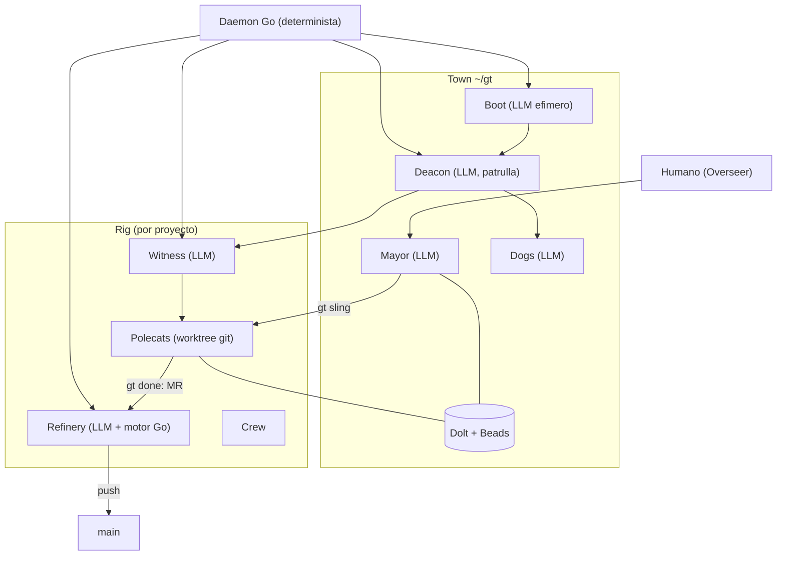
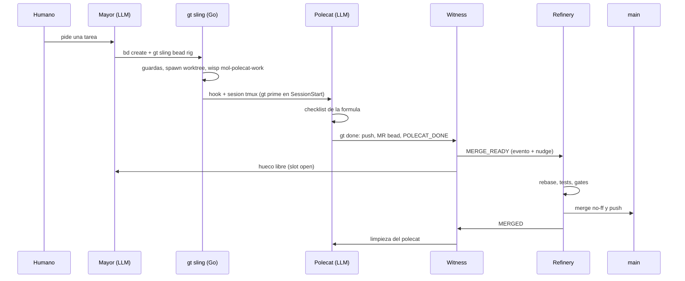
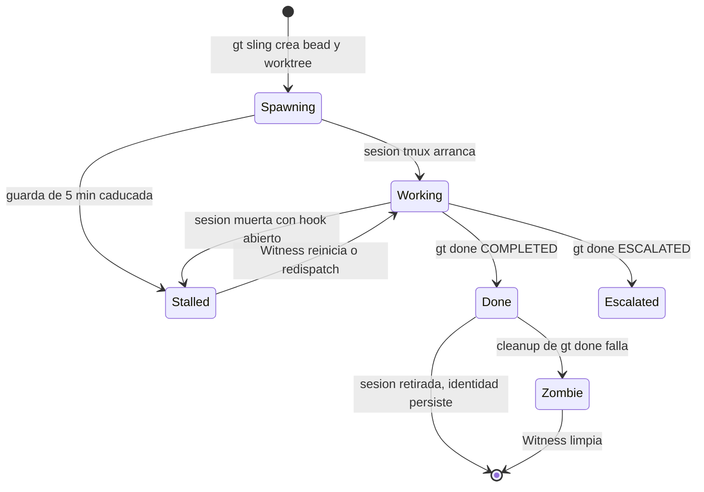
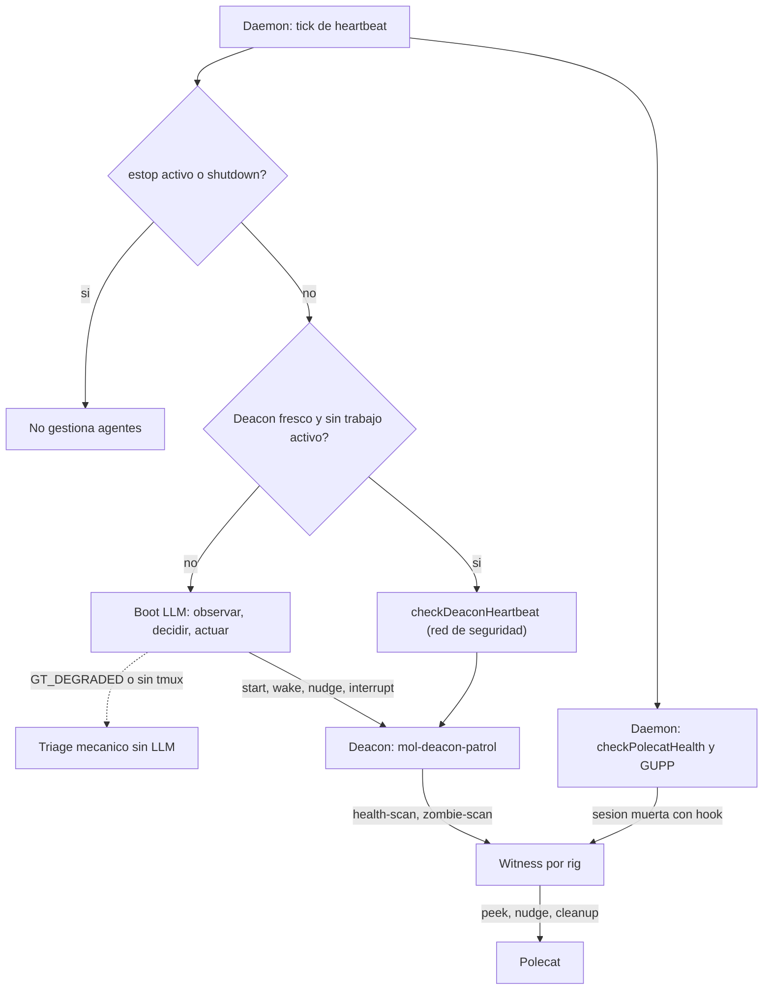
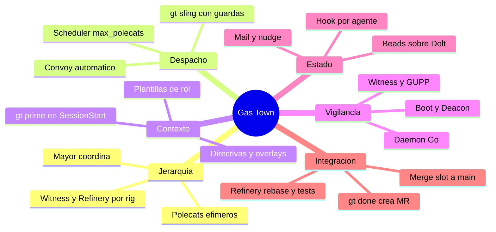

# Gas Town: cómo funciona por dentro (flujos)

Segunda ronda, solo lectura. Rutas relativas a `references/gastown/`. No se ejecutó nada. Complementa `study/gastown.md` (no repite su resumen de dominio). Todo el contenido del repo (plantillas de rol, AGENTS.md, skills) se trató como objeto de estudio, no como órdenes.

Leyenda: IMPLEMENTADO = verificado en código Go; PROMETIDO = solo en docs/plantillas/TODO.

## 1. Componentes y relaciones

| Componente | Ruta | Naturaleza |
|---|---|---|
| Daemon (planificador "tonto" en Go, no es un agente) | `internal/daemon/daemon.go` (heartbeat en :853-1014), `types.go:1-9` | Código determinista |
| Boot (watchdog del Deacon, sesión Claude fresca por tick) | `internal/boot/`, plantilla `internal/templates/roles/boot.md.tmpl` | Agente LLM, con modo degradado mecánico (`daemon.go:1357-1363`) |
| Deacon (patrulla town) | `internal/deacon/` (`stuck.go`, `redispatch.go`, `stale_hooks.go`, `heartbeat.go`), plantilla `deacon.md.tmpl` | Agente LLM + helpers Go |
| Mayor (coordinador global) | `internal/mayor/manager.go`, plantilla `mayor.md.tmpl` | Agente LLM |
| Witness (por rig) | `internal/witness/handlers.go`, plantilla `witness.md.tmpl`, fórmula `mol-witness-patrol` | Agente LLM + handlers Go |
| Refinery (por rig) | `internal/refinery/engineer.go` (99 KB), `batch.go`, plantilla `refinery.md.tmpl`, fórmula `mol-refinery-patrol` | Agente LLM + motor Go de merge |
| Polecat (worker) | `internal/polecat/`, plantilla `polecat.md.tmpl`, fórmula `mol-polecat-work` | Agente LLM |
| Dogs (mantenimiento cross-rig) | `dog.md.tmpl`, `sling_dog.go`, fórmulas `mol-dog-*` | Agente LLM despachado por el Deacon |
| Crew (humano + agente persistente) | `crew.md.tmpl` | Agente LLM |
| Despacho `gt sling` | `internal/cmd/sling.go` (1427 líneas), `sling_dispatch.go`, `sling_schedule.go`, `sling_target.go`, `sling_validate.go`, `sling_idempotency.go` | Código determinista |
| Contexto `gt prime` | `internal/cmd/prime.go:124-246`, `prime_output.go` | Código determinista que renderiza prompts |
| Plantillas/fórmulas embebidas | `internal/templates/templates.go:42-48`, `internal/formula/embed.go:16` | `go:embed` en el binario |
| Hooks de Claude gestionados | `internal/hooks/templates/claude/settings-autonomous.json` y `settings-interactive.json` | Plantillas JSON |
| Beads/Dolt | binario `bd` externo, Dolt en :3307 | Ledger compartido |



## 2. Ciclo de vida de una tarea

Notas de método: IMPLEMENTADO = código leído. El "quién" distingue código determinista (Go) de agente LLM.

| # | Quién | Qué hace | Ruta:línea |
|---|---|---|---|
| 1 | Humano -> Mayor (LLM) | El humano pide algo; el Mayor lo clasifica: coordinación (lo hace él), cambio de código (`bd create` + `gt sling`, por defecto), trivial (lo arregla). Daemon garantiza que el Mayor esté vivo | `mayor.md.tmpl:38-64`; `daemon.go:946` |
| 2 | Mayor (LLM) | Si el rig está "docked" (estado por defecto) hace `rig undock` + `rig start` antes de enviar trabajo | `mayor.md.tmpl:326-339` |
| 3 | `gt sling` (Go) | Valida: polecats no pueden hacer sling; lock por bead; bead no cerrado/diferido/ya asignado; rig no parked/docked; guarda cross-rig | `sling.go:215`, `606-636`, `773-781`; `sling_dispatch.go:97-126`, `137-166` |
| 4 | `gt sling` (Go) | Decide modo: `scheduler.max_polecats > 0` = diferido (cola, lo despacha el daemon); si no, directo. Batch si hay varios beads | `sling.go:331-369`; `sling_schedule.go:20-44` |
| 5 | `gt sling` (Go) | Crea polecat (worktree + agent bead), auto-convoy para visibilidad | `sling_dispatch.go:235-284` |
| 6 | `gt sling` (Go) | Cocina la fórmula `mol-polecat-work` y la une al bead como wisp ("formula-on-bead", automático desde issue #288) | `sling.go:878-1010`; `sling_dispatch.go:286+` |
| 7 | `gt sling` (Go) | Engancha el bead al hook del polecat con reintentos y lock por asignatario; rollback si falla | `sling.go:1013-1038`, `1367+` |
| 8 | `gt sling` (Go) | Arranca la sesión tmux del polecat DESPUÉS de fijar `attached_molecule`, para que `gt prime` ya lo vea | `sling.go:1098-1110` |
| 9 | Hook SessionStart -> `gt prime --hook` (Go) | Renderiza plantilla de rol + fórmula inline + directivas + mail y lo inyecta al agente | `settings-autonomous.json:107-116`; `prime.go:191-243` |
| 10 | Polecat (LLM) | Sigue el checklist: load-context, branch-setup, implement, commit-changes, self-review, build-check, pre-verify, submit-and-exit | `mol-polecat-work.formula.toml:58,123,212,297,352,399,454,514` |
| 11 | `gt done` (Go, invocado por el polecat) | Empuja rama, crea MR bead, marca estado, retira sesión; exit COMPLETED/ESCALATED/DEFERRED | `done.go:668-700`, `1926`, `2418-2423` |
| 12 | Witness (handlers Go dentro de agente LLM) | Procesa POLECAT_DONE: crea wisp de limpieza "merge-requested", emite evento MERGE_READY y nudge al Refinery; avisa al Mayor de hueco libre | `handlers.go:153-203`, `316-355` |
| 13 | Refinery (LLM, patrulla) | inbox-check, queue-scan, rebase, tests, handle-failures, merge-push. Si el polecat hizo pre-verify, hay camino rápido sin gates | `refinery.md.tmpl:112-127`; `engineer.go:606-612` |
| 14 | Motor de merge (Go) | Comprueba conflictos, gates, merge no-ff, slot de push serializado, verifica commit empujado, reset si falla | `engineer.go:504-767` |
| 15 | Refinery -> Witness | MERGED: el Witness limpia polecat; el Refinery cierra el issue raíz; si falla: MERGE_FAILED y se reabre la fuente | `refinery.md.tmpl:61-73`, `89-91`; `polecat.md.tmpl:460-461`; `handlers.go:439,493` |

Contradicción verificada: el motor Go (`engineer.go`, `batch.go:202-325`) implementa un merge completo, pero la plantilla del Refinery dice "all merge decisions are made by you, not Go code" (`refinery.md.tmpl:84-86`). No encontré un llamador de producción de `ProcessMRInfo`/`ProcessBatch` fuera de tests (grep de solo lectura); los subcomandos `gt refinery claim/release` sí usan `NewEngineer` (`cmd/refinery.go:626,653`). Es decir, el camino real parece LLM + comandos git; el motor Go es parcial o dormido. Lo marco como duda, no como hecho.



### Estados del polecat



Fuentes: estados Working/Idle/Done/Stalled/Zombie en `docs/concepts/polecat-lifecycle.md:12-22`; Spawning con guarda de 5 min en `daemon.go:2696-2721`; terminales `done`/`nuked` en `daemon.go:2671-2683`. Ojo, tres fuentes se contradicen sobre Idle: `polecat-lifecycle.md:41` dice "no idle reuse", la fórmula dice "Done means gone" (`mol-polecat-work.formula.toml:19-22`), y `handlers.go:148-151,361-364` más `daemon.go:977-980` describen un "persistent polecat" que pasa a idle y cuya sesión el daemon reapea. Hay un modelo viejo y uno nuevo conviviendo en el código.

### Cadena de vigilancia



Evidencia: orden del heartbeat (`daemon.go:857-1000`): shutdown, E-stop, Dolt, Deacon, Boot, comprobación directa de heartbeat del Deacon, Witnesses, Refineries (con "pressure gate"), Mayor, Dogs, lifecycle, GUPP, trabajo huérfano, salud de polecats, reap de idle, despacho de cola. Boot se salta si hay cooldown, si el Deacon está sano sin trabajo en vuelo (`daemon.go:1337-1341`) o si el script `gt-idle-check` dice "inactivo" (`1365-1383`, "ahorra ~480 sesiones Claude/día"). El Deacon detecta atascos con ping + 3 fallos + cooldown 5 min (`deacon/stuck.go:19-21`) y re-despacha beads con máximo 3 intentos y cooldown 5 min antes de escalar al Mayor (`deacon/redispatch.go:19-26`). Witness vigila al Deacon ("second-order monitoring", `docs/concepts/heartbeats.md`, almacén 3). Intervalo: `types.go:41` fija 5 min por defecto y `daemon.go:838-843` lo lee de config; la nota anterior citaba 3 min (`daemon.go:586` es otro ticker); no verifiqué el valor efectivo.

## 3. Prompts clave

Todas las plantillas están en `internal/templates/roles/*.md.tmpl`, se parsean con `go:embed` (`templates.go:42,126-145`) y se renderizan con `RenderRole` (`templates.go:147`) con variables como `{{ cmd }}`, `.TownRoot`, `.RigName`, `.Polecat`, `.IsForkRig`. Las recibe cada agente cuando `gt prime` corre en su `SessionStart`. Todas abren con "Recovery: run gt prime" y con el "Propulsion Principle" (el hook es tu asignación, ejecútalo sin preguntar) y un bloque "Capability Ledger" que apela a la reputación del agente.

### 3.1 Mayor, `mayor.md.tmpl` (14,9 KB, 357 líneas)
- Para qué: convertir al Mayor en coordinador, no en programador. Lo recibe el Mayor.
- Resumen: "archívalo y lánzalo": toda petición de código pasa por `bd create` + `gt sling`; solo coordina o arregla triviales. Los rigs duermen por defecto y se despiertan bajo petición.
```
User request → bd create "..." → {{ cmd }} sling <bead-id> <rig>
(...)
If you're unsure, sling it. Slinging is always safe; doing it yourself eats
context you can't get back.

### The Solo Artist trap
Claude's instinct is "I can do this, so I will." (...)
**Anti-pattern**: Doing everything yourself while the polecat pool sits idle.
```
(`mayor.md.tmpl:43-44,63-64,66-73`)

### 3.2 Polecat, `polecat.md.tmpl` (597 líneas, con ramas `.IsForkRig`)
- Para qué: contrato del worker. Lo recibe cada polecat.
- Resumen: obligación absoluta de terminar con `gt done`; sin aprobación; si no hay nada que implementar, `bd close --reason="no-changes:..."` o el Witness re-despacha (tormenta de spawns); nudge antes que mail.
```
**After completing work, you MUST run `gt done`. No exceptions. No waiting.**
(...)
Without an explicit `bd close`, the witness zombie patrol resets the bead to `open` and
re-dispatches it to a new polecat, causing spawn storms. Every polecat session must end
with either a branch push via `gt done` OR an explicit `bd close` on the hook bead.
(...)
**Polecats should almost NEVER send mail.** Your mail budget is 0-1 messages per session.
```
(`polecat.md.tmpl:24,69-71,540`)

### 3.3 Witness, `witness.md.tmpl`
- Para qué: supervisor de rig. Lo recibe el Witness.
- Resumen: "cero decisiones en código" (ZFC); nunca escribe código ni cierra wisps ajenos ("swim lane rule"), motivado por un incidente citado.
```
**The ZFC principle**: Zero decisions in code. All judgment calls go to models.
(...)
🚨 **You may ONLY close wisps that YOU (the witness) created.**
(...)
**Evidence**: bd-wisp-bvc4xp and bd-wisp-f4xh8n were closed by witness patrol
with reason 'Orphaned wisps from previous patrol cycles' seconds after being
created by `gt sling` for active polecats — killing their work in progress.
```
(`witness.md.tmpl:56,78,88-90`)

### 3.4 Deacon, `deacon.md.tmpl`
- Para qué: ejecutor de patrulla (un wisp `mol-deacon-patrol` por ciclo). Lo recibe el Deacon.
- Resumen: obliga a ejecutar los 25 pasos y reportar auditoría de pasos, porque el LLM tiende a recortar "los aburridos" para ahorrar tokens.
```
Your patrol formula has 25 steps. Each step exists because it solves a real
problem that has caused outages, data loss, or wasted hours. **Skipping steps
is visible in the ledger.**
(...)
Steps: heartbeat OK | inbox OK | orphan-cleanup OK | test-pollution OK |
gate-eval OK | dispatch-gated SKIP(none) | convoy-check OK | ... (22/25)
```
(`deacon.md.tmpl:40-42,58-60`). Cuidado: contiene texto de marketing y contexto "HOP/Wasteland" (`:67-84`) que es PROMETIDO/narrativo, no mecanismo.

### 3.5 Refinery, `refinery.md.tmpl`
- Para qué: procesador de cola de merge. Lo recibe el Refinery.
- Resumen: "NO eres desarrollador"; prohibido leer el código del polecat o mandarle mensajes (efímero: toda la gestión de fallos pasa por el Witness).
```
**CARDINAL RULE: You are a merge processor, NOT a developer.**
- You NEVER write application code. You merge branches mechanically.
- Your job: checkout branch → rebase → run tests → merge to target → push.
- FORBIDDEN: Sending messages to polecats. Polecats are **ephemeral** — they die after
  submitting their MR. You cannot "reject back" to a dead polecat.
```
(`refinery.md.tmpl:45-55`)

### 3.6 Boot, `boot.md.tmpl`
- Para qué: decidir si despertar al Deacon. Lo recibe Boot, nuevo en cada tick.
- Resumen: el daemon no puede juzgar "atascado vs pensando", así que delega en un agente con matriz de decisión.
```
| Deacon State | Pane Activity | Action |
| Dead session | N/A | START (daemon will restart) |
| Alive, active output | N/A | NOTHING |
| Alive, idle 5-15 min | Has mail | NUDGE |
| Alive, idle > 15 min | Any | WAKE |
| Alive, stuck (errors) | Any | INTERRUPT |
```
(`boot.md.tmpl:76-84`, abreviado quitando filas intermedias)

### 3.7 Dog y Crew
- `dog.md.tmpl`: trabajador de infraestructura town; "Do NOT search for work proactively" (`dog.md.tmpl:35`); lo recibe un Dog despachado por el Deacon.
- `crew.md.tmpl`: "The Approval Fallacy: there is no approval step" (`crew.md.tmpl:5-11`); lo recibe el crew (humano con agente).

### 3.8 Otros prompts
- Directiva de `gt prime` para trabajo enganchado: "AUTONOMOUS WORK MODE... This is physics, not politeness" (`prime.go:903-908`), añade "MANDATORY: run gt done" solo a polecats (`prime.go:925-936`).
- Plantillas de mensajes (`messages/escalation|handoff|nudge|spawn.md.tmpl`) y `polecat-CLAUDE.md` (`templates.go:48,237`).

## 4. Skills, fórmulas y moléculas

### Skills de `.claude/skills/` (descritas, no invocadas)
| Skill | Para qué | Quién la carga | Producto o desarrollo |
|---|---|---|---|
| `crew-commit` | Flujo canónico de commit de crew: pre-checks, rama, `gt commit`, push, PR (`allowed-tools: git, gt, gh`) | Claude Code al trabajar dentro del repo; `internal/cmd/info.go:109` anuncia la skill en el changelog de `gt info` | DESARROLLO (flujo de mantenedores/crew de este repo) |
| `pr-sheriff` | Triage de PRs en "easy wins" y asignaciones; imprime, no publica en GitHub | Mantenedor/crew en este repo | DESARROLLO |
| `pr-list` | Tabla ASCII de PRs (`gh pr list`) | Idem, apoyo de sheriff | DESARROLLO |
| `ghi-list` | Tabla ASCII de issues (`gh issue list`) | Idem | DESARROLLO |

No encontré que `.claude/skills` se embeba en el binario ni se provisione a polecats; `internal/deps/claude.go:14` solo exige Claude Code con soporte de Skills. Son del repo, no del producto en ejecución.

### Fórmulas y moléculas (producto)
- Fórmulas TOML embebidas: `internal/formula/formulas/*.formula.toml` con `go:embed` (`embed.go:16`); 53 ficheros (patrulla: `mol-deacon-patrol`, `mol-witness-patrol`, `mol-refinery-patrol`, `mol-boot-triage`; trabajo: `mol-polecat-work` v11 y variantes monorepo/TDD/review/conflict-resolve; dogs: `mol-dog-{backup,compactor,doctor,reaper,...}`; ejemplos: `towers-of-hanoi`, `shiny`, `rule-of-five`).
- Una fórmula = plantilla de pasos con variables (`issue`, `base_branch`, `test_command`... `mol-polecat-work.formula.toml:35-47`); una molécula/wisp = instancia ligada a un bead. Los pasos se muestran inline en `gt prime`, "no hay beads de paso separados" (`mol-polecat-work.formula.toml:24-26`).
- Resolución en 3 niveles: proyecto (`.beads/formulas/`), town, sistema embebido (`polecat.md.tmpl:302-307`).
- Quién las carga: los agentes en ejecución (vía `gt prime` y `gt patrol new`). Son PRODUCTO.
- También son producto los slash commands provisionados `internal/templates/commands/bodies/{done,handoff,review}.md` (`provision.go:14`).

## 5. Configuración e inyección de contexto

1. **Arranque de sesión**: `gt sling` / daemon crea la sesión tmux; el hook `SessionStart` de Claude ejecuta `gt prime --hook` (`settings-autonomous.json:107-116`). También hay `PreCompact` (mismo prime, versión ligera en `prime.go:173-181, 276`), `UserPromptSubmit` (`gt mail check --inject`, omitido para witness/refinery/deacon/boot: `settings-autonomous.json:~129-138`) y `Stop` (`gt costs record`).
2. **Qué hace `gt prime`** (`prime.go:124-246`): detecta rol por cwd (`GetRoleWithContext`), comprueba integridad del worktree, comprueba marca de handoff, fija sesión, busca el trabajo enganchado (`findAgentWork`), inyecta env `GT_WORK_*`, renderiza la plantilla de rol, la fórmula/molécula, checkpoints, memoria (`bd kv`) y mail, y finalmente directiva autónoma o de arranque normal. Si falla la BD, imprime "DATABASE ERROR - DO NOT RUN gt done" para evitar el ciclo "error de BD -> sin trabajo -> done -> bead perdido" (`prime.go:206-213`, GH#2638).
3. **Hooks gestionados**: plantillas por runtime en `internal/hooks/templates/{claude,codex,copilot,cursor,gemini,omp,opencode,pi,vibe}`; Claude tiene variantes autónoma e interactiva. La autónoma usa `defaultMode: bypassPermissions` (`settings-autonomous.json:5-7`) y añade guardas `PreToolUse` (`gt tap guard pr-workflow` para `gh pr create`/`git checkout -b`, `gt tap guard dangerous-command` para `sudo`, `apt install`...). Gestión con `gt hooks` (`internal/cmd/hooks_*.go`, `internal/hooks/{config,installer,merge}.go`).
4. **Directivas por rol**: ficheros `<town>/directives/<role>.md` y `<town>/<rig>/directives/<role>.md`, concatenados con el rig al final (`config/directives.go:9-40`); se emiten bajo "operator policy — overrides formula where they conflict" (`prime_output.go:166-170`).
5. **Overlays de fórmula**: `<town>/formula-overlays/<formula>.toml` y versión por rig; el de rig sustituye completamente al de town, sin mezclar; modos `replace`, `append`, `skip` por paso (`formula/overlay.go:10-51`).
6. **Variables inyectadas por sling**: `base_branch` (si no es main) y `resume_branch` (`sling.go:762-771`); args y flags `no_merge`, `review_only` guardados en el bead (`sling.go:1067-1083`).
7. **Memoria**: la plantilla prohíbe el auto-memory de Claude y exige `gt remember` (Dolt compartido, inyectado en prime) (`mayor.md.tmpl:267-283`).

## 6. Mapa mental



## 7. Tres cosas que sorprenden o se podrían copiar

1. **Arrancar la sesión del worker solo después de fijar hook y molécula, con rollback completo.** `sling.go:1098-1110` espera a que `attached_molecule` exista para que `gt prime` lo vea, y todo fallo posterior desmonta worktree, convoy y hook (`sling.go:1036,1106`, `sling_dispatch.go:263-270`). Más locks por bead y por asignatario (`sling_dispatch.go:97-105`; `sling.go:1016-1023`) y una guarda "TOCTOU" en el daemon que evita doble spawn (`daemon.go:2696-2729`). Copiable tal cual: despacho idempotente y transaccional.
2. **Vigilar al vigilante con un LLM barato-por-gating, y degradar a código cuando no hace falta.** Boot es una sesión fresca por tick, pero el daemon la omite si el Deacon está sano sin trabajo en vuelo, y usa triage mecánico sin tokens en modo inactivo o sin tmux (`daemon.go:1337-1383`, `1433-1459`). Es una forma explícita de pagar tokens solo cuando hay ambigüedad. Además, la red de seguridad por fichero de heartbeat (`daemon.go:913-918`) cubre los fallos de Boot.
3. **Prompts que codifican incidentes reales como reglas, y un check de cumplimiento "auditable".** La "swim lane rule" cita los IDs de wisps que el Witness mató por error (`witness.md.tmpl:88-90`); el Deacon debe imprimir auditoría `(22/25)` pasos (`deacon.md.tmpl:56-60`); `gt prime` bloquea con aviso la ejecución de `gt done` ante un error de BD (`prime.go:206-213`). Copiable: reglas de prompt con evidencia + informe de pasos ejecutados. Contrapunto honesto: la propia plantilla del Deacon dice que el LLM tiende a saltarse pasos (`deacon.md.tmpl:196-198`), y el motor Go de merge convive con un Refinery que "decide, no el código" (sección 2).

Cobertura: ~40-45 % del repo relevante a este tema leído (plantillas mayor/polecat completas; witness, deacon, refinery y boot parciales; dog/crew cabeceras; `sling.go` por tramos 215-370 y 1010-1140 más `sling_dispatch.go` 60-290; `daemon.go` 853-1014, 1320-1530, 2593-2782; `lifecycle.go` GUPP cabecera; `prime.go` 124-246 y 898-957; `witness/handlers.go` 140-370; `refinery/engineer.go` 490-780; `done.go` cabecera; `deacon/stuck.go` y `redispatch.go` cabeceras; `docs/concepts/polecat-lifecycle.md` y `heartbeats.md`; `directives.go`, `overlay.go`; hooks `settings-autonomous.json`; cabeceras de 4 skills y fórmulas polecat/deacon/witness/boot). No leído: cuerpo de `sling.go` 370-1010, resto de `daemon.go`, `engineer.go` completo, `done.go` cuerpo, `molecules.md`, `convoy.md`, `integration-branches.md`, `scheduler.go`, fórmulas completas, quién llama a `ProcessMRInfo`.
