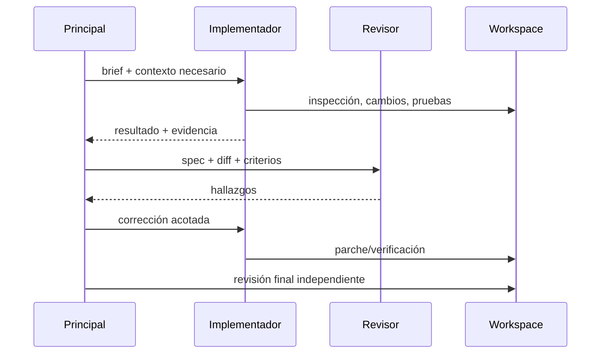

# 07. Subagentes y orquestación

La etiqueta “subagentes” no dice qué prompt reciben, si heredan historial, si comparten workspace, qué tools tienen, cómo se paralelizan, qué devuelven o quién integra.

OpenCode documenta primary/subagents, prompt/model/tools configurables y Plan con acceso restringido. Kimi Code README declara coder/explore/plan en contextos aislados. Qwen Code documenta subagentes configurables y, según su nota de diseño oficial del 2026-10-05, colaboración A2A por sesiones implementada detrás de `experimental.agentCollaboration` (apagada por defecto). La actualización oficial del 2026-10-15 anuncia colaboración con Claude Code y Codex como compañeros; los adaptadores de Qwen no demuestran soporte A2A nativo en esas CLI. Gemini CLI documenta conexiones a agentes remotos A2A mediante Agent Cards. Esto prueba capacidades expuestas, no eficacia ni seguridad medida.

Para cada dispatch registrar modelo, system/developer prompt, contexto exacto, herramientas/permisos, workspace, concurrencia, presupuesto, salida, errores e integración. Verificar aislamiento en runtime, no asumirlo por descripción.
## A2A: qué interoperabilidad prueba realmente

A2A estandariza la comunicación entre sistemas de agentes: descubrimiento por Agent Card, mensajes, tareas con estado y resultados. La especificación dice expresamente que no define cómo un agente invoca sus subagentes o herramientas. MCP cubre agente↔herramienta/datos; ACP cubre editor↔agente. Tener MCP, ACP o subagentes internos no demuestra A2A.

La evidencia oficial revisada muestra dos capacidades distintas:

| Producto / capa | Capacidad verificada | Límite de la evidencia |
|---|---|---|
| Gemini CLI: cliente | Consume agentes remotos A2A definidos por Agent Card | Cliente A2A documentado y código de invocación localizado |
| Gemini CLI: servidor | El repo incluye `packages/a2a-server` y paquete ejecutable propio | El issue oficial #14535 describe el servidor original como “A2A-like” y no plenamente conforme. El manifest observado fija `@a2a-js/sdk` 0.3.11; no se ha ejecutado TCK ni prueba cruzada. Clasificar como servidor A2A existente con conformidad actual no demostrada |
| Hermes Agent: plugin oficial | A2A v1.0 de entrada y salida: Agent Card, JSON-RPC, streaming/SSE y tools para descubrir/llamar agentes | Plugin plugins/platforms/a2a; activación/configuración por plataforma. PR #86660 (15-08-2026) corrige registro de tools para CLI/TUI; disponibilidad depende del gateway/plugin y su configuración. Evidencia de producto, no una prueba nuestra contra pares independientes |
| Qwen Code: endpoint A2A externo | Servicio A2A para invocadores autorizados; mapea una tarea a un run y `contextId` a una sesión | `experimental.agentCollaboration` desactivado por defecto; JSON-RPC es el único binding congelado, polling sin streaming/push; el contrato dice que la interoperabilidad independiente no se ha demostrado |
| CodeBuddy Code CLI: cliente y servidor | v2.143+ documenta descubrimiento/invocación saliente y `--a2a` como servicio JSON-RPC por stdio (`SendMessage`, `GetTask`, `ListTasks`, `CancelTask`); v2.145 añade modo mixto con `stream-json` | Evidencia de documentación oficial de producto, no revisión del código ni TCK independiente; comparte política de permisos/sesión |
| OpenClaw: canal A2A genérico | Plugin oficial A2A 1.0 expone Agent Card/JSON-RPC y llama a peers configurados | No es un coding agent dedicado; sin streaming, push, cancelación o lista de tareas; tareas en memoria y peers tratados como confiables |
| Qwen Code: coordinación de sesión | `@`-delegación y agentes locales/remotos mediante un coordinador, adaptadores Qwen/ACP y Claude/Codex/stdio; puede encadenar menciones | Es la orquestación propia de Qwen; el Host remoto usa un protocolo interno v2. No significa que Claude Code o Codex sean peers A2A nativos |

La especificación tampoco impone un directorio global: Agent Cards pueden localizarse por URL well-known, catálogos o configuración directa. El cliente obtiene credenciales fuera de banda y el servidor aplica autorización propia. En el contrato Qwen, el invocador A2A no puede aprobar una operación de herramienta: el run queda `INPUT_REQUIRED` y el propietario del workspace responde localmente. Compartir el formato de mensajes no elimina la configuración de descubrimiento, identidad, permisos ni la intervención humana.

### Por qué parece que cada CLI va por su cuenta

| Factor | Efecto observable | Grado de certeza |
|---|---|---|
| Capas de protocolo distintas | ACP estandariza integración de editor; MCP, acceso a tools/datos; A2A, comunicación entre agentes. Se confunden porque las tres aparecen en productos agentic, pero no se sustituyen | Verificado en especificaciones oficiales |
| Diseño local primero | Muchos subagentes son procesos, roles, modos o sesiones internos. A2A exige además una interfaz de servicio, descubrimiento, identidad/autenticación y ciclo de tareas remotas | Inferencia arquitectónica apoyada por diseño A2A y diferencias de implementación |
| Diferencias semánticas | Contexto, workspace, aprobaciones, permisos, cancelación, retries, estado y artefactos se modelan distinto; A2A deja varias políticas y autorizaciones a la implementación | Verificado parcialmente en especificación y contrato Qwen |
| Seguridad y confianza | Delegar a otro proceso local y enviar una tarea a un servicio remoto tienen fronteras de datos y credenciales distintas. A2A requiere autenticación/HTTPS, pero no decide el permiso concreto de cada acción de coding | Verificado en la especificación; motivación de cada proveedor no verificada |
| Disponibilidad por superficie | Un plugin puede tener A2A en gateway pero no registrar tools en CLI/TUI; el estado del protocolo depende también del runtime que carga el plugin | Caso Hermes: bug documentado y corregido en PR #86660 |
| Madurez y compatibilidad parcial | Un producto puede implementar solo un binding o capacidades opcionales, y declarar “A2A” sin que se haya probado interoperabilidad cruzada | Verificado en opciones de binding/capacidades de A2A y nota Qwen |
| Incentivos comerciales | Mantener coordinación, memoria y permisos propios puede preservar UX y control del proveedor | Hipótesis; no atribuir como motivo sin declaraciones primarias |

Por eso la frase «cada uno hace la guerra por su cuenta» es razonable como descripción de la interoperabilidad por defecto, pero no como afirmación de incompatibilidad técnica absoluta. La prueba útil no es encontrar “A2A” en docs: es conectar dos implementaciones independientes y verificar descubrimiento, autenticación, envío, seguimiento, cancelación, aprobación, artifacts y errores, registrando el binding y las capacidades negociadas.
